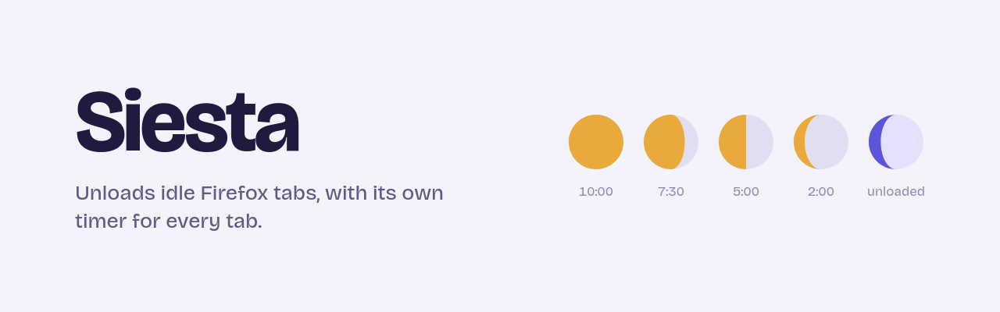
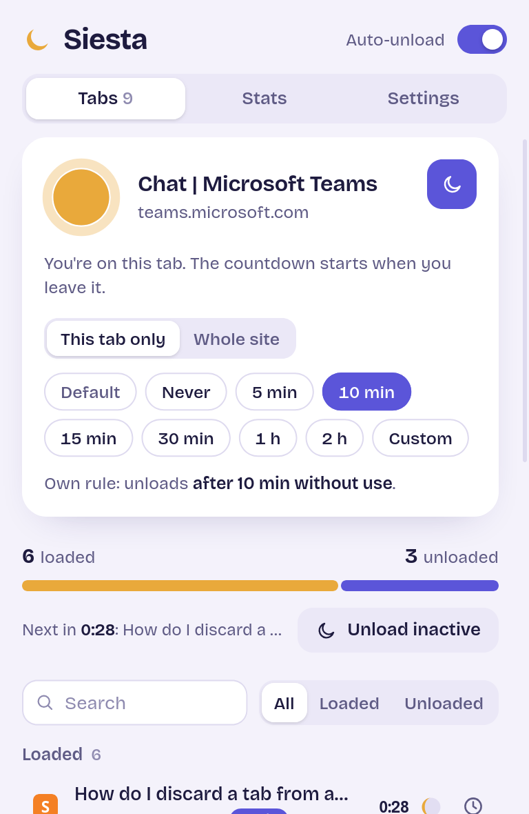
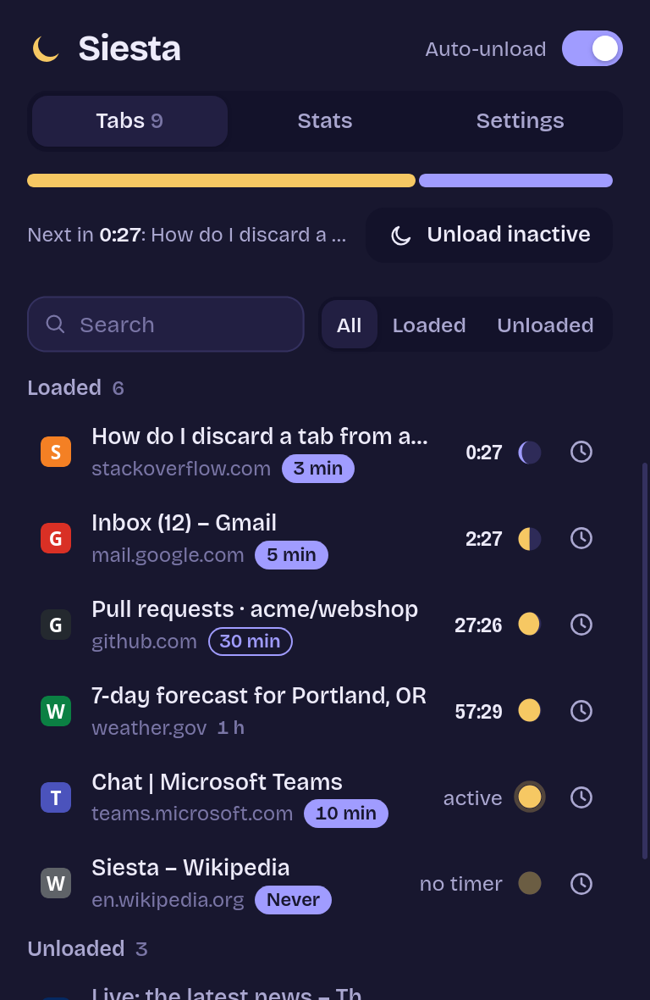
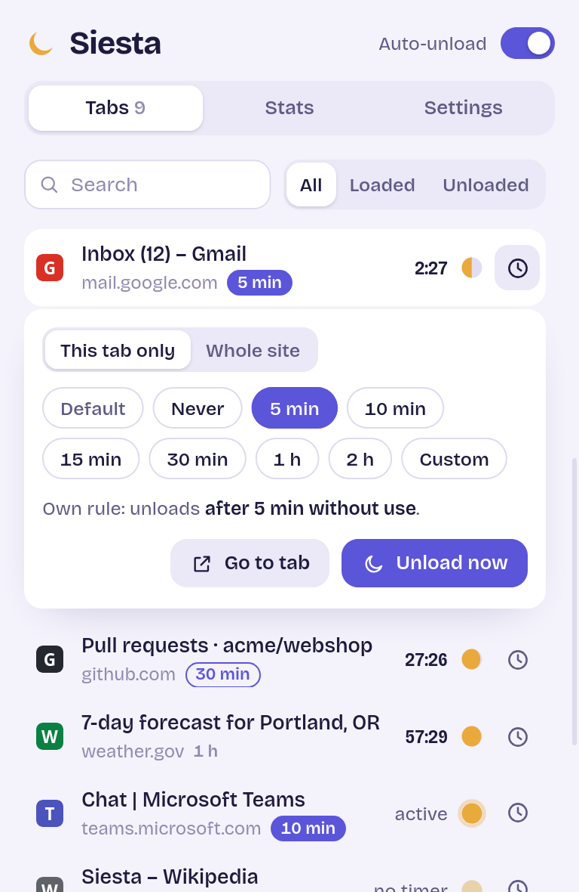
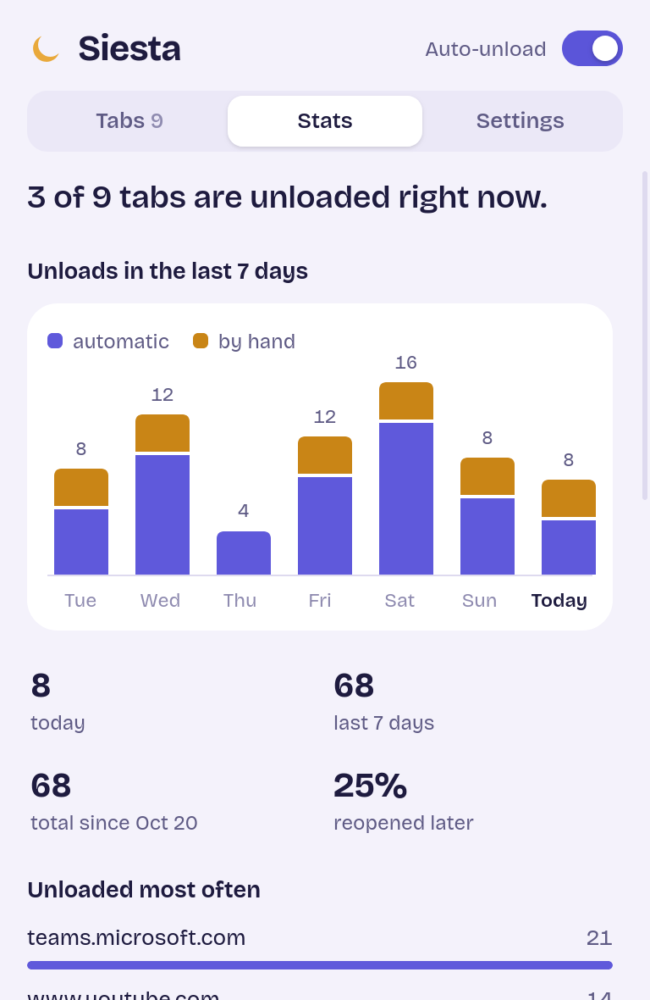
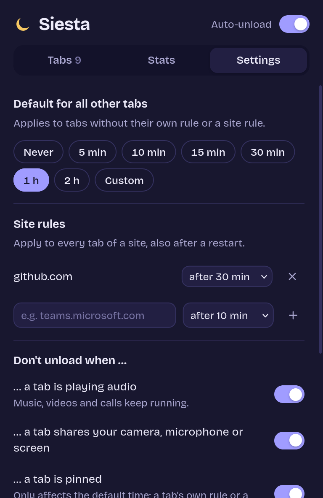
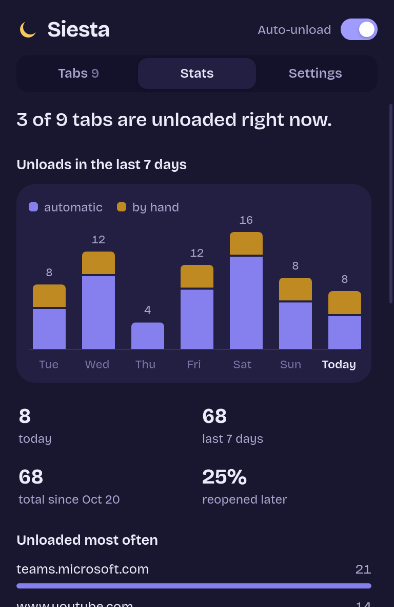

<p align="center">
  <picture>
    <source media="(prefers-color-scheme: dark)" srcset="docs/images/banner-dark.png">
    
  </picture>
</p>

<p align="center">
  <a href="https://addons.mozilla.org/firefox/addon/siesta-tabs/"></a>
  <a href="https://github.com/DevEmperor/Siesta/actions/workflows/ci.yml"></a>
  
  <a href="LICENSE"></a>
</p>

<p align="center">
  <b>Let idle tabs take a nap.</b><br>
  Siesta unloads Firefox tabs you haven't used for a while, so their memory is freed –
  and you decide for every tab how long that while is.
</p>

<p align="center">
  <a href="https://addons.mozilla.org/firefox/addon/siesta-tabs/"><b>Get it for Firefox</b></a> ·
  <a href="#how-it-works">How it works</a> ·
  <a href="#faq">FAQ</a> ·
  <a href="#development">Development</a>
</p>

---

## Highlights

- **A timer for every tab** – keep Microsoft Teams loaded for 10 minutes after you leave
  it, a news site for an hour, and never touch your music tab. Pick never, 5, 10, 15 or
  30 minutes, 1 or 2 hours, or any custom time up to 24 hours.
- **Site rules** – one timer for every tab of a site, e.g. `teams.microsoft.com`.
- **A default, if you want one** – for all tabs without their own rule (off out of the box).
- **Everything in the popup** – current tab, timers, overview, stats and settings live in
  the toolbar popup. There is no separate options page.
- **Live overview** – which tabs are loaded and which are unloaded, a countdown for each
  tab and the one that unloads next. A small moon wanes as a tab gets closer to its nap.
- **Unload by hand** – a single tab, the tab you're on, or every inactive tab at once;
  also from the tab context menu, for several selected tabs.
- **Stays out of your way** – tabs playing audio and tabs sharing your camera, microphone
  or screen stay loaded. Pinned tabs only unload with their own or a site rule.
- **Stats** – unloads of the last 7 days, the sites unloaded most often, recent unloads and
  how many unloaded tabs you opened again later.
- **Private** – no data collection, nothing is sent anywhere.

## Screenshots

<table>
  <tr>
    <td align="center"><br><sub><b>The current tab</b> – pick its timer</sub></td>
    <td align="center"><br><sub><b>Overview</b> – countdowns and unloaded tabs</sub></td>
    <td align="center"><br><sub><b>Any tab</b> – own rule or site rule</sub></td>
  </tr>
  <tr>
    <td align="center"><br><sub><b>Stats</b> – a week of unloads</sub></td>
    <td align="center"><br><sub><b>Settings</b> – right in the popup</sub></td>
    <td align="center"><br><sub><b>Light and dark</b> – follows Firefox</sub></td>
  </tr>
</table>

<sub>Tab titles and numbers in the screenshots are made up.</sub>

## Install

**From Firefox Add-ons:** [addons.mozilla.org/firefox/addon/siesta-tabs](https://addons.mozilla.org/firefox/addon/siesta-tabs/)
– requires Firefox 142 or newer on the desktop.

**From source, for a test run** (gone after a browser restart): clone this repository,
open `about:debugging#/runtime/this-firefox`, click *Load Temporary Add-on…* and pick
`manifest.json`.

## How it works

1. **The idle clock** starts when you leave a tab – Firefox records that moment for every
   tab. The tab you're on, in any window, is never unloaded automatically.
2. **Which timer applies:** a tab's own rule beats a site rule, which beats the default.
   *Never* is a rule too, so you can exempt one tab from a site rule or the default.
3. **When the time is up**, Siesta asks Firefox to unload the tab (`tabs.discard`). It stays
   in the tab bar with its title and icon; clicking it loads the page again.
4. **What keeps a tab loaded:** playing audio or sharing camera, microphone or screen
   (when audio stops, the clock starts over), being pinned (unless the tab has its own or
   a site rule), or the pause switch in the popup header.

Tab rules are stored with the tab in Firefox's session data, so they survive a browser
restart; site rules, settings and stats are kept in the add-on's local storage. Siesta
checks timers with alarms timed to the next due tab, plus a sweep once a minute.

## FAQ

<details>
<summary><b>How much memory does this save?</b></summary>

It depends on the page – a web app like Teams usually holds far more than a plain
article. Firefox doesn't tell add-ons how much memory a single tab uses, so Siesta shows
no RAM figures rather than made-up ones. `about:processes` in Firefox shows the real
numbers.
</details>

<details>
<summary><b>Do I lose anything when a tab is unloaded?</b></summary>

The tab keeps its history and scroll position. Firefox restores text you typed into forms
on most pages, but not on every one – give tabs with unsaved work a longer timer or
*Never*. While a tab is unloaded it can't do anything in the background: an unloaded
Teams or mail tab sends no notifications until you open it again.
</details>

<details>
<summary><b>Can I unload the tab I'm on?</b></summary>

Yes, with the moon button in the popup or *Unload now* in the tab context menu. Firefox
can't unload the selected tab, so Siesta first switches to the tab you used before.
</details>

<details>
<summary><b>Does it work in private windows?</b></summary>

Only if you allow it: *about:addons* → Siesta → *Run in Private Windows*.
</details>

<details>
<summary><b>Why these permissions?</b></summary>

| Permission | Used for |
| --- | --- |
| `tabs` | Reading tab titles and addresses for the list and for site rules |
| `storage` | Settings, site rules and stats |
| `alarms` | Unloading tabs on time |
| `sessions` | Keeping a tab's own rule across browser restarts |
| `menus` | The *Siesta* entry in the tab context menu |
</details>

## Development

Siesta is plain JavaScript without a build step – what's in the repository is what
Firefox runs.

```bash
npm ci               # web-ext and puppeteer-core for the tests
npm start            # Firefox with the add-on loaded (web-ext run)
npm run lint         # Mozilla's add-on linter
npm test             # unit tests for the timer logic
npm run test:e2e     # end-to-end test in a headless Firefox (about 90 s)
npm run build        # unsigned dist/siesta-<version>.xpi for testing
npm run publish      # submit to addons.mozilla.org (asks for your API key)
```

| Path | What it does |
| --- | --- |
| `background.js` | Timers, unloading, stats, toolbar badge, tab context menu |
| `lib/core.js` | Shared logic: resolving rules, tab status, formatting |
| `popup/` | The popup: current tab, tab list, stats and settings |
| `tests/` | Unit tests and the headless Firefox test, which also renders the screenshots |
| `amo-metadata.json` | Listing text for addons.mozilla.org |

The end-to-end test runs a copy of the add-on in Firefox through WebDriver BiDi, sets
real one-minute timers and checks that the right tabs get unloaded.
`node tests/e2e.mjs --shots docs/images [--dark]` renders the screenshots above.

## Credits

- Typeface: [Bricolage Grotesque](https://github.com/ateliertriay/bricolage) by the
  Bricolage Grotesque Project Authors (Atelier Triay), SIL Open Font License 1.1
  (`fonts/OFL.txt`).

## License

[MIT](LICENSE)
